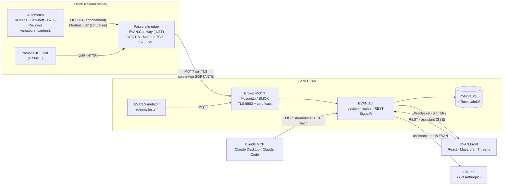
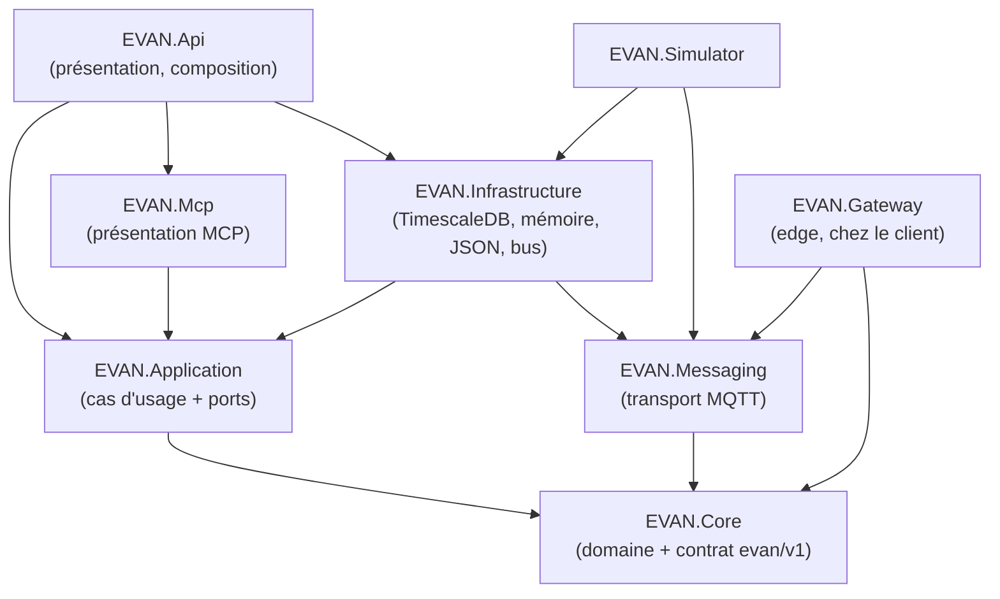

# EVAN — architecture

EVAN est une application web de supervision d'usine. On retrouve l'usine sur une vue satellite, on relève son
emprise exacte, on obtient un plan 3D, on y place les machines, on les connecte, puis on supervise en temps réel
jusqu'à l'organe en défaut (rouleau, groupe d'impression, sécheur, couteau…). L'exploitation se poursuit dans le carnet
de maintenance, l'énergie, la vue d'ensemble de l'organisation et l'assistant « Demander à EVAN », dont les outils sont
aussi servis en MCP : voir [EXPLOITATION.md](EXPLOITATION.md).

## 1. Vue d'ensemble



Principes :

- **La passerelle n'ouvre aucun port entrant** : elle se connecte au broker, comme un navigateur à un site web.
  Le pare-feu de l'usine n'a qu'une règle sortante à autoriser (TCP 8883).
- **Lecture seule par défaut** : aucune écriture vers un automate sans activation explicite sur la passerelle,
  un opérateur nommé, une raison, et une ligne dans le journal des écritures.
- **La passerelle choisit ce qu'elle teste** : un test de liaison ne joint que l'hôte d'une connexion déclarée ou une
  cible de `Gateway:AllowedTestTargets` (noms, adresses, plages CIDR ; vide par défaut), jamais une adresse imposée
  depuis l'API. Le back n'adresse la demande qu'à la passerelle de l'usine visée. Détails dans
  [COMMUNICATION.md](COMMUNICATION.md) § 6.
- **Un seul contrat** de messages (`evan/v1/...`, JSON versionné) entre passerelle, simulateur et back : la démo
  utilise exactement le chemin de production.
- **La démo tourne aussi sans back** : le front embarque un simulateur et un moteur de règles identiques
  (`src/EVAN.Front/src/sim/`), ce qui permet d'ouvrir `/demo` n'importe où, sans compte ni serveur.

## 2. Arborescence

Un seul dépôt, une seule solution (`EVAN.slnx`), un dossier par livrable sous `src/`, nommé `EVAN.<Rôle>`.

```
EVAN/
├── EVAN.slnx                   ← solution unique : src, tests, tools (+ fichiers du front, non compilés par dotnet)
├── Directory.Build.props       ← réglages .NET communs : cible net10.0 (net9.0 avec un SDK 9), nullable, InternalsVisibleTo
├── Directory.Packages.props    ← versions NuGet centralisées (les .csproj citent un paquet sans version)
├── docker-compose.yml          ← tout en local : broker TLS, TimescaleDB, API, simulateur, front (+ profil edge)
├── docker-compose.prod.yml     ← surcharge de mise en ligne : Caddy en HTTPS devant nginx, images GHCR (DEPLOIEMENT.md)
├── .editorconfig · .gitignore · .dockerignore · .env.example
│
├── src/
│   ├── EVAN.Core/              ← DOMAINE + CONTRAT. Aucune dépendance.
│   │   ├── Contracts/          ←   contrat MQTT evan/v1 : Topics, Json, TelemetryMessage, StateMessage, PlcAlarmMessage,
│   │   │                           GatewayMessages (présence, test de liaison, écriture), SimulatorCommands
│   │   └── Domain/
│   │       ├── Sites/          ←   Organisation, Site (+ repère local), Batiment, Zone, DemoSite
│   │       ├── Machines/       ←   Machine, Organe, PointDeMesure (+ Seuils), Connexion
│   │       ├── Catalog/        ←   Catalogue (+ énergie, plan de maintenance, cylindres), Kit, MachineModel, ReferenceData
│   │       ├── Alarms/         ←   Alarme, Evenement, RulesEngine (seuils, dérive, répétitif, automate)
│   │       ├── Exploitation/   ←   historique (IHistorique, périodes, TRS), Energie, Maintenance, Chronologie, Aleatoire
│   │       └── Diagnostics/    ←   DefautRepetitif (pas mesuré → cylindre ou rouleau)
│   ├── EVAN.Application/       ← CAS D'USAGE + PORTS
│   │   ├── Abstractions/       ←   ports : IStore, IComptesStore, IMotsDePasse, IMessageBus, IRealtimeNotifier, IHistoryReader
│   │   ├── Live/               ←   LiveService (ingestion, règles, alarmes, actions opérateur), SiteRuntime, trace de détection,
│   │   │                           Registre (usines chargées, démo et organisations réelles, rechargées sans redémarrage)
│   │   ├── Comptes/            ←   ComptesService : installation d'une organisation, comptes admin et membre, connexion
│   │   ├── Usines/             ←   UsinesService (configuration enregistrée), ValidationUsine, ConfigurationPasserelle
│   │   ├── Connections/        ←   ConnectionTestService (test de liaison relayé à la passerelle)
│   │   ├── Exploitation/       ←   ExploitationService (alarmes, arrêts, chronologie, carnet, énergie, diagnostic), CarnetService
│   │   ├── Assistant/          ←   EvanTools (outils de l'assistant et du serveur MCP), AssistantService (port IChatClient)
│   │   ├── Observabilite/      ←   Metriques : mesures métier « EVAN » (System.Diagnostics.Metrics, sans OpenTelemetry)
│   │   └── DependencyInjection.cs
│   ├── EVAN.Messaging/         ← TRANSPORT MQTT (MQTTnet) : MqttConnection (TLS mutuel, reconnexion), MqttSettings
│   ├── EVAN.Infrastructure/    ← ADAPTATEURS DU BACK
│   │   ├── Messaging/          ←   MqttMessageBus (port IMessageBus), MqttIngestionService (evan/v1/+/+/+ → LiveService)
│   │   ├── Persistence/        ←   PostgresStore (COPY binaire, agrégat continu ; comptes et usines enregistrées dans
│   │   │                           PostgresStore.Referentiel ; carnet dans PostgresStore.Carnet), MemoryStore, Schema.sql,
│   │   │                           Carnet.sql (migration additive du carnet), StoreInitializer
│   │   ├── Reference/          ←   JsonReferenceData (data/*.json)
│   │   ├── Simulation/         ←   HistoriqueSimule (identique au navigateur), SimulatedHistoryReader (port IHistoryReader)
│   │   ├── Assistant/          ←   AddEvanAssistant : SDK Anthropic → IChatClient, exécution des outils
│   │   └── DependencyInjection.cs
│   ├── EVAN.Api/               ← PRÉSENTATION + COMPOSITION
│   │   ├── Securite/           ←   Session (cookie, rôles), AccesUsines (cloisonnement), EssaisConnexion, ProtectionEcritures,
│   │   │                           MotsDePasse (PasswordHasher), GardeIa (assistant et MCP)
│   │   ├── Endpoints/          ←   un fichier par ressource (Health, Session, Organisation, Catalog, Site, Passerelle, Point,
│   │   │                           Alarm, Connection, Demo,
│   │   │                           Exploitation, Assistant) ; EvanApi = table des routes (+ /mcp)
│   │   ├── Realtime/           ←   SupervisionHub (SignalR), SignalRNotifier (port IRealtimeNotifier), TelemetryBroadcaster (1 Hz)
│   │   ├── Observabilite/      ←   Telemetrie : OpenTelemetry (traces, métriques, journaux), OTLP si un collecteur est désigné
│   │   ├── DependencyInjection.cs
│   │   └── Program.cs          ←   AddEvanApplication · AddEvanInfrastructure · AddEvanApi · MapEvanApi
│   ├── EVAN.Mcp/               ← SERVEUR MCP : outils EvanTools en Model Context Protocol (Streamable HTTP, lecture seule)
│   ├── EVAN.Simulator/         ← WORKER DE DÉMO : machines simulées → MQTT, passerelle de démonstration
│   ├── EVAN.Gateway/           ← WORKER EDGE (installé dans l'usine)
│   │   ├── Sources/            ←   IMachineSource, MachineSourceFactory, OpcUa/Modbus/S7/Jmf, ISampleSink, IWritableSource
│   │   ├── Publishing/         ←   TelemetryPublisher (file bornée, envoi groupé, reprise après coupure)
│   │   ├── Security/           ←   WriteGuard (lecture seule par défaut, journal des écritures),
│   │   │                           GardeTestLiaison (cibles des tests de liaison, adresse vérifiée)
│   │   └── Configuration/      ←   GatewayOptions, MachineConnection, PointMapping
│   └── EVAN.Front/             ← FRONT React + TypeScript (Vite)
│       ├── index.html · package.json · vite.config.ts · tsconfig.json
│       ├── public/             ←   icônes et image de partage (générées par npm run icones), manifeste, robots.txt
│       ├── build/              ←   étapes du build : modèles du kit allégés, balises de partage absolues si EVAN_URL_PUBLIQUE est posée
│       └── src/
│           ├── app/            ←   main.tsx (entrée), router.tsx (routes /, puis /demo/<écran> et /assistant/<écran>)
│           ├── pages/          ←   une page par adresse : landing (accueil), workspace (mise en page commune : carte,
│           │                       scène 3D, barre, fenêtres), puis un écran par dossier : localiser, plan, machines,
│           │                       organes, connexion, supervision, historique, maintenance, energie, organisation.
│           │                       À la racine d'une page, seulement index.tsx (qui l'assemble) et index.css (son style,
│           │                       s'il en a un) ; le reste dans des sous-dossiers : features/ (composants de l'écran),
│           │                       hooks/, lib/ (logique et données sans rendu).
│           ├── widgets/        ←   blocs partagés par plusieurs pages : scene (3D et plan 2D), carte (satellite, emprise),
│           │                       shell (barre, rail, navigation, adresses des écrans, zones), tour (visite guidée),
│           │                       assistant, charts, pannes (fiche d'alarme, panne rejouée, défaut répétitif),
│           │                       intervention, usines (sélecteur, organisation)
│           ├── domain/         ←   types du modèle (miroir de EVAN.Core), catalogue machines
│           ├── analytics/      ←   énergie, maintenance, chronologie d'une panne, défaut répétitif, organisation (+ tests)
│           ├── geo/            ←   géodésie, recherche, emprise BD TOPO/OSM, tuiles (+ tests)
│           ├── sim/            ←   simulateur navigateur, moteur de règles, historique simulé (+ tests, contrat front = back)
│           ├── realtime/       ←   source temps réel : simulateur local ou SignalR (EVAN.Api)
│           ├── api/            ←   appels à EVAN.Api (en-tête X-Evan des écritures), configuration d'usine envoyée et relue
│           ├── store/          ←   état zustand : projet (organisation et usines), interface, temps réel, carnet, session,
│           │                       enregistrement côté serveur
│           ├── ui/             ←   composants et utilitaires partagés (logo, format, états, sparkline)
│           └── styles/         ←   système de design, un fichier par thème (jetons clair/sombre, base, composants,
│                                   barres, scène, panneau…) ; app.css les importe dans l'ordre de la cascade
│
├── tests/
│   ├── Directory.Build.props   ← socle xUnit commun : un projet de test = une référence au projet testé
│   ├── EVAN.Core.Tests/        ← moteur de règles (cas communs avec le front), défaut répétitif, énergie
│   ├── EVAN.Application.Tests/ ← chaîne de détection de bout en bout (panne → alarme critique → trace complète),
│   │                              validation et rechargement des usines enregistrées
│   ├── EVAN.Infrastructure.Tests/ ← données de référence, schéma SQL embarqué, contrat de l'historique simulé (front = back),
│   │                               assistant face à un faux serveur Anthropic (cache, effort, coût), jeu d'évaluation,
│   │                               stockage sur une vraie TimescaleDB (Testcontainers, voir § 9)
│   ├── EVAN.Mcp.Tests/         ← un vrai client MCP liste les outils et en appelle un (serveur de test ASP.NET Core)
│   ├── EVAN.Api.Tests/         ← garde de l'assistant et du MCP : accès, origine, bornes, débit, concurrence, quota ;
│   │                               routes d'écriture et hub : passerelle et usine visées, bornes, cohérence d'usine ;
│   │                               comptes et session, accès croisé entre organisations (404 sur chaque route, hub),
│   │                               usines enregistrées, configuration de passerelle
│   ├── EVAN.Gateway.Tests/     ← file d'envoi, état publié, valeurs OPC UA, garde des tests de liaison
│   ├── EVAN.Architecture.Tests/   ← règles de dépendance entre projets (voir § 3)
│   └── e2e/                    ← bout en bout Playwright (Chromium), son propre package.json : voir § 9
├── tools/
│   └── EVAN.DevBroker/         ← broker MQTT de développement (sans Docker, sans TLS)
│
├── data/                       ← données partagées front / back (lues par Vite et copiées à côté des exécutables .NET)
│   ├── catalog.json            ←   points de mesure (unité, nominale, seuils), forme de panne, cause et intervention type,
│   │                               cylindres, puissance par état, plan de maintenance ; facteur CO₂ et prix par défaut
│   ├── demo.json               ←   organisation d'exemple : Valtiq, usines de Tours (14 machines) et de Crissey (8)
│   ├── tests/                  ←   cas de test communs front / back (moteur de règles, historique simulé, défaut
│   │                               répétitif), questions d'évaluation de l'assistant (réponses recalculées par le back)
│   └── kit/                    ←   kit fourni (source de vérité, non modifié) : modeles/*.glb, machines.json, base de connaissances
├── infra/
│   ├── caddy/Caddyfile         ← proxy TLS de la mise en ligne : certificat Let's Encrypt, HTTP vers HTTPS, HSTS
│   ├── docker/                 ← dotnet.Dockerfile (un projet .NET au choix : PROJECT=EVAN.Api…), front.Dockerfile
│   ├── mosquitto/              ← mosquitto.conf (TLS + mTLS), acl, gen-certs.sh, ajouter-passerelle.sh (une usine réelle)
│   └── nginx/                  ← default.conf (front + relais /api et /hubs) ; relais.conf en local, relais-tls.conf
│                                   derrière Caddy (adresse du client et protocole d'origine)
├── scripts/dev.ps1             ← lance broker, API, simulateur et front sans Docker
└── docs/                       ← ARCHITECTURE.md (ce document), COMMUNICATION.md, DEMO.md, DEPLOIEMENT.md
```

## 3. Back .NET : couches et règles de dépendance



| Projet | Contient | Dépend de |
|---|---|---|
| **Core** | `Domain/` : sites, machines, catalogue, alarmes et **moteur de règles** (seuils, dérive, répétitif, automate). `Contracts/` : sujets et messages MQTT versionnés. | rien (bibliothèque standard seule) |
| **Core** (suite) | `Domain/Exploitation` : historique (`IHistorique`), énergie, maintenance (NF EN 13306), chronologie d'une panne, aléa déterministe. `Domain/Diagnostics` : défaut répétitif. | rien |
| **Application** | `LiveService` : ingestion de la télémétrie, évaluation des règles, états machine, acquittement, résolution (et son annulation dans les 30 s), panne de démonstration, trace de détection. `ConnectionTestService`. `ExploitationService` et `CarnetService`. `EvanTools` (outils, définis une fois) et `AssistantService`. `ComptesService` (comptes et organisations), `UsinesService` et `ValidationUsine` (configuration d'une usine réelle), `ConfigurationPasserelle`. **Ports** : `IStore`, `IComptesStore`, `ICarnetStore`, `IMotsDePasse`, `IMessageBus`, `IRealtimeNotifier`, `IHistoryReader`, `IChatClient` (abstraction Microsoft.Extensions.AI). | Core |
| **Messaging** | `MqttConnection` (connexion sortante, TLS mutuel, reconnexion, abonnements rejoués), `MqttSettings`, `AddEvanMqtt`. | Core |
| **Infrastructure** | `MqttMessageBus` (requête/réponse), `MqttIngestionService` ; `PostgresStore` (schéma idempotent embarqué, COPY binaire par lots, agrégat continu) et `MemoryStore` ; `JsonReferenceData` ; `HistoriqueSimule` (port `IHistoryReader` de la démo) ; `AddEvanAssistant` (SDK Anthropic → `IChatClient`). | Application, Messaging |
| **Mcp** | `AddEvanMcp` / `MapEvanMcp` : chaque outil d'`EvanTools` devient un outil MCP annoté lecture seule, transport Streamable HTTP sans état. | Application |
| **Api** | Points d'accès REST (un fichier par ressource), `SupervisionHub` SignalR, `SignalRNotifier`, `TelemetryBroadcaster` (envoi groupé 1 Hz), assistant en SSE, serveur MCP sur `/mcp`, `GardeIa` (accès, débit et coût de l'assistant et du MCP), session par cookie, cloisonnement par organisation (§ 10), empreinte des mots de passe (`PasswordHasher` du framework partagé). | Application, Infrastructure, Mcp |
| **Simulator** | Machines simulées (même comportement que le simulateur du navigateur), passerelle de démonstration. | Infrastructure, Messaging |
| **Gateway** | Sources OPC UA, Modbus TCP, S7, JMF ; publication bornée ; garde-fou d'écriture ; garde des tests de liaison (`Gateway:AllowedTestTargets`). | Core, Messaging |

**La passerelle installée chez le client n'embarque que le contrat et le transport** : ni pilote PostgreSQL, ni cas
d'usage, ni ASP.NET. Ces règles ne reposent pas sur la discipline : `tests/EVAN.Architecture.Tests` lit les
références des assemblages compilés et échoue si un projet utilise une couche interdite (par exemple Application →
Infrastructure, ou Gateway → Npgsql, même indirectement). Ils vérifient aussi que le serveur MCP ne voit ni la base, ni le
broker, ni le SDK du modèle, et que les cas d'usage ne connaissent que l'abstraction `IChatClient`.

Le moteur de règles existe en deux exemplaires de même logique : `src/EVAN.Core/Domain/Alarms/RulesEngine.cs` et
`src/EVAN.Front/src/sim/rules.ts` (pour la démo hors ligne). Les deux jouent les mêmes cas de test,
`data/tests/regles.json`, et doivent émettre les mêmes alarmes dans le même ordre.
Il en va de même de l'historique simulé, de l'énergie, de la maintenance, de la chronologie d'une panne et du défaut
répétitif : des cas de test communs (`data/tests/`) vérifient, des deux côtés, les mêmes résultats à la milliseconde près
(voir [EXPLOITATION.md](EXPLOITATION.md) § 1).

## 4. Modèle de données

| Entité | Champs clés | Remarque |
|---|---|---|
| Organisation | id, nom | une ou plusieurs usines ; celle de la démo vient de `data/demo.json`, celle de l'entreprise de `POST /api/installation` (une seule fois) |
| Compte | identifiant (adresse e-mail), nom, rôle (`admin` ou `membre`), empreinte du mot de passe | rattaché à une seule organisation ; identifiant unique dans toute l'installation |
| Site (usine) | adresse, coordonnées, **repère local** (origine + angle), SIRET, **passerelle**, surface annoncée, configurée | le repère aligne x sur le grand côté du bâtiment ; une passerelle edge par usine (attribuée par le serveur si le front n'en donne pas) |
| Bâtiment | contour lon/lat, **précision de chaque sommet**, hauteur, niveaux, source (`bdtopo`/`osm`/`manuel`), cleabs, **identifiant RNB** | |
| Zone | type (atelier, stock, expédition, prépresse, façonnage, bureaux), polygone en mètres, niveau (0 = rez-de-chaussée) | |
| Machine | type du catalogue, nom, numéro, position, rotation, modèle 3D, niveau (0 = rez-de-chaussée) | |
| Organe | numéro, nom, nœud 3D (`diag_N_nom`), position dans le modèle, capteurs, pannes typiques, méthode, alarme de l'automate | |
| PointDeMesure | type (tension, température, vitesse, pression, alarme…), unité, nominale, **seuils** (attention/alarme bas/haut), protocole, adresse | |
| Connexion | protocole, paramètres, état, associations variable → point, **lecture seule** | |
| Alarme | code, gravité, organe, horodatage, valeur, seuil, statut, **règle**, cause probable, répétitions, acquittement (qui, quand) | le délai d'acquittement nourrit le temps moyen d'acquittement |
| Intervention (saisie) | machine, organe, type (curative, préventive, observation), date, durée, compte rendu, intervenant, tâche du plan | une tâche du plan réalisée remet son compteur à zéro, y compris une tâche suivie par une mesure d'usure |
| Intervention planifiée | machine, organe, tâche du plan, intitulé, date prévue, durée, intervenant, point en dérive | attend son jour dans « À faire » ; consignée, elle devient une saisie |
| Événement | type, message, auteur, horodatage | journal (dont autorisations d'écriture) |

Identifiants stables partagés front/back : organe `{machineId}.o{numero}`, point `{machineId}.o{numero}.{cle}` (ou
`{organeId}.p-…` pour une mesure saisie à la main).
Bâtiments, zones et machines ont des identifiants **uniques dans toute l'organisation** (vérifié par les tests) : la base,
les sujets MQTT `evan/v1/{site}/…` et les flux temps réel par site s'appuient dessus. Pour une usine enregistrée par une
organisation réelle, le serveur l'exige à chaque enregistrement, et dans toute l'installation : un identifiant déjà pris
par une autre usine est refusé (409) sans que l'usine en cause soit nommée si elle est à une autre organisation.
Identifiants d'usine, de machine et de passerelle : lettres, chiffres, `-` et `_` (un segment de sujet MQTT).
Côté base : référentiel relationnel (organisations, `comptes`, sites et leurs dépendances ; colonnes ajoutées de façon
idempotente pour les bases existantes), `mesures` et `etats_machine` en hypertables TimescaleDB (`mesures` compressées
après 1 jour, rétention 400 jours, agrégat continu `mesures_1min` compressé après 2 jours). Voir `src/EVAN.Infrastructure/Persistence/Schema.sql`.
Le carnet de maintenance tenu à l'écran est dans ses propres tables (`carnet_saisies`, `carnet_prevues`, clé
`(site_id, id)`), créées par `Carnet.sql`, joué après le schéma à chaque démarrage. Sans base, il reste en mémoire.

**Carnet et alarmes en REST.** Le navigateur en mode API envoie chaque geste du carnet au serveur, pour que l'assistant
et le serveur MCP voient le même carnet. Chaque route porte le `siteId` (cloisonnement du § 10) et ne touche qu'aux
lignes et aux machines de cette usine ; elle est ouverte sans compte sur la démo, comme la saisie.

| Route | Rôle |
|---|---|
| `POST /api/alarms/{id}/reopen` | annule une clôture faite il y a 30 s au plus, par la même organisation (la démo sans compte en est une) ; 409 sinon |
| `GET`, `POST /api/sites/{siteId}/interventions` | saisies de l'usine ; consigner une intervention (ou la remettre, même identifiant) |
| `PUT`, `DELETE /api/sites/{siteId}/interventions/{saisieId}` | corriger ou retirer une saisie, inscrit au journal de l'usine |
| `GET`, `POST /api/sites/{siteId}/interventions/prevues` | interventions planifiées ; planifier ou déplacer (même identifiant) |
| `DELETE /api/sites/{siteId}/interventions/prevues/{prevueId}` | annuler une intervention planifiée, ou la retirer une fois consignée |

Le client (`realtime/apiSource.ts`) envoie les écritures d'une même saisie ou d'une même intervention planifiée l'une
après l'autre : le serveur les reçoit dans l'ordre des gestes, « Annuler » compris.

## 5. Étape 1 : relever l'emprise au m² près

La surface d'une usine change tout le reste (plan, implantation, coûts) : EVAN la mesure, et dit avec quelle précision.

1. **Trouver le site** : recherche unifiée adresse (Géoplateforme IGN, autocomplétion), **nom d'entreprise ou SIRET**
   (annuaire des entreprises), **coordonnées GPS ou lien Google Maps collés**, repli mondial (Photon/OSM).
   Chaque résultat dit ce qu'il désigne vraiment (badge) : point exact, numéro de rue, **rue entière**, établissement
   SIRENE, commune.
2. **Choisir le bon bâtiment** (`src/EVAN.Front/src/geo/candidates.ts`) — une adresse ne désigne pas toujours un bâtiment :
   - point GPS ou numéro de rue : le bâtiment BD TOPO qui **contient** le point est retenu d'office ;
   - rue entière (« ZI du Menneton, avenue Thérèse Voisin ») : EVAN prend la **géométrie de la voie** (tronçons BD TOPO portant
     l'identifiant BAN de la rue) et propose les bâtiments qui la bordent (≤ 70 m), **lettrés A–F** sur la carte et
     dans le panneau, classés par taille (√surface), usage industriel et distance ; l'utilisateur confirme ;
   - établissement SIRENE : la position SIRENE peut être décalée de plusieurs centaines de mètres (270 m dans la
     démo) ; l'**adresse postale est re-géocodée** (mentions « ZI », « BP », « CEDEX » retirées) puis traitée
     comme ci-dessus, l'écart est signalé ;
   - un site sur plusieurs bâtiments : on les choisit l'un après l'autre ; la position du site devient celle du premier
     bâtiment retenu.
3. **Voir les bâtiments selon le zoom** : orthophoto IGN (Esri hors de France) ; à partir du zoom 15, les bâtiments
   BD TOPO en tuiles vectorielles, **industriels en ambre**, trait qui s'épaissit avec le zoom ; survol = surface
   approximative et hauteur ; relief 3D optionnel avec les vraies hauteurs.
4. **Détecter l'emprise** : clic ou point d'adresse → géométrie complète par WFS (les tuiles sont découpées) avec
   hauteur, étages, usage, identifiant RNB, précision planimétrique ; OpenStreetMap (Overpass) en repli.
   Sans bâtiment sous le point, EVAN choisit le plus probable : proche, grand, industriel.
5. **Mesurer exactement** : surface **géodésique sur l'ellipsoïde WGS84** (algorithme de Karney, GeographicLib),
   périmètre, longueurs de côté, plus petit rectangle englobant (dimensions, orientation), surface de plancher, volume.
6. **Dire la précision** : chaque sommet porte un écart-type ; l'incertitude de surface est propagée
   (σ_A = ½·√Σ σᵢ²·|pᵢ₊₁ − pᵢ₋₁|²). Sur la carte, **le halo cyan a l'épaisseur réelle de l'incertitude en mètres** :
   il paraît plus large en pixels quand on zoome, et s'affine quand on corrige.
7. **Corriger** : sommets déplaçables à partir du zoom 16 (aimantation à 90° sur les axes du bâtiment), insertion
   par les milieux de côtés, suppression au double-clic, « Équerrer », « Simplifier », annuler/rétablir, tracé manuel.
   Un sommet replacé hérite d'une précision qui dépend **du zoom auquel on l'a posé** (précision de l'orthophoto ⊕ taille
   d'un pixel) : zoomer davantage rend le relevé plus précis.
8. **Plusieurs bâtiments** : un clic sur un autre bâtiment l'ajoute au site, total recalculé.

Sur l'usine d'exemple (Valtiq, entreprise fictive, ZI du Menneton à Tours) : bâtiment A « production »
5 999 m² ± 191 m² (BD TOPO, précision 3 m), bâtiment B « prépresse » 972 m², total 6 971 m² pour 7 000 m² annoncés
(−0,4 %). Seconde usine, Crissey · Ateliers Brennac (48 rue Paul Sabatier) : bâtiment BD TOPO
`BATIMENT0000000348750006`, relié à l'adresse par le RNB (`WRHTT88Z39RH`), 4 842 m² ± 206 m². Les emprises sont
réelles, retenues pour leur forme ; l'entreprise et ses usines sont inventées.

## 6. Front

- **Deux espaces** :
  - **Exploitation** (écran par défaut d'une usine configurée) : onglets *Supervision* (bandeau d'indicateurs, plan 3D/2D,
    panneau Alarmes · Machines · Journal), *Historique* (tableau de bord), *Maintenance* (carnet, panne rejouée, défaut
    répétitif) et *Énergie* ; au-dessus, la *vue d'ensemble* de l'organisation (sélecteur d'usine) et le panneau
    *Demander à EVAN* ;
  - **Configuration** (étapes 1 à 5 : emprise, plan, machines, organes, connexions) **derrière un accès explicite** :
    bouton « Configurer », fenêtre de confirmation, ouverture inscrite au journal ; « Terminer » ramène à la supervision.
    Une nouvelle usine (`/assistant`) commence dans cet espace, puis bascule en exploitation une fois terminée.
- **React 19 + TypeScript**, Vite, **zustand** pour l'état ; routes `/`, puis un écran par adresse sous `/demo` et `/assistant`
  (`/demo/plan`, `/demo/maintenance`…). La mise en page reste montée d'un écran à l'autre : la scène 3D ne se recharge pas.
- **Organisation et usines** : le store garde l'organisation et toutes ses usines ; l'usine active est « dépliée » à sa
  racine (site, bâtiments, zones, machines, connexions), si bien que les écrans n'ont pas à savoir qu'il en existe
  d'autres. Changer d'usine range l'active, déplie la suivante, relance le flux temps réel sur son site et reprend
  l'écran adapté (exploitation si elle est configurée, étape 1 sinon). Une usine laissée vide n'est pas conservée.
  L'assistant demande le nom de l'organisation avant de commencer ; tout est sauvegardé dans le navigateur
  (`evan.assistant.v2`, l'ancien format à une usine est repris).
- **Recharts** pour tous les graphiques (courbes de mesure avec seuils, arrêts empilés, TRS jour par jour, Pareto des
  codes, micro-courbes temps réel, répartition des états).
- **MapLibre GL** pour le satellite et les tuiles vectorielles ; **React Three Fiber** (drei, camera-controls) pour la 3D
  et le plan 2D ; SVG pour la carte des arrêts de l'historique.
- **Plan 2D = la même scène vue de dessus** par une caméra orthographique : les vrais modèles 3D des machines, leurs états
  animés, à l'échelle exacte (1 unité = 1 m ; le zoom de la caméra donne les pixels par mètre, d'où une barre d'échelle
  juste). Plan orienté sur les axes du bâtiment, nord géographique indiqué ; fond « plan » épuré (dalle, trait de mur,
  grille 1 m / 5 m) ou orthophoto ; cotes des murs (pas sur les murs mitoyens, murs courts au zoom) ; étiquettes compactes
  sous les machines, noms au zoom ; zones nommées dans leur coin. Glisser = déplacer la vue, molette = zoom vers le
  curseur, pincement au doigt. Étape 2 : tracé des zones au glisser (cotes et surface en direct), coins tirables,
  déplacement d'une zone. La bascule 3D ⇄ 2D est continue : la caméra 3D se redresse à la verticale au cadrage du plan
  avant le passage, et repart de la vue de dessus au retour.
- **Continuité** : au passage étape 1 → 2, la carte s'incline et s'aligne sur le bâtiment, puis la scène 3D reprend
  exactement le même point de vue (même focale de 36,87°, même distance), sur une orthophoto composée des mêmes tuiles.
  Ensuite, la caméra enchaîne sans coupure site → machine → organe.
- **Placement** : glisser-déposer depuis la bibliothèque, aimantation 50 cm, **poignées de rotation aux quatre coins**
  de la machine sélectionnée, dans toutes les étapes de configuration où elle est visible (3 à 5), en 3D comme en 2D :
  au survol d'un coin le curseur devient une flèche circulaire ; on l'attrape et la machine pivote autour de son centre,
  aimantée tous les 15° (Alt : au degré près), angle affiché en direct ; un simple appui = un quart de tour. Les poignées
  gardent la même taille à l'écran (13 px) de la vue d'ensemble au gros plan.
- **Machines vivantes** : `rotatif_N` tournent à `vitesseRadS × vitesse réelle`, `bande_N` défilent, voyants selon
  l'état ; la presse ralentit puis s'arrête quand elle tombe en panne.
- **États lisibles** par couleur, **forme** (●, ▲, ■, ◆, ○) et animation (pulsation, faisceau au-dessus de la machine).
- **Accessibilité** : `prefers-reduced-motion` (plus de rotation, de pulsation ni de vol de caméra, bascule manuelle),
  thèmes clair et sombre, cibles tactiles de 44 px, mise en page tablette.

## 7. Choix et alternatives

| Sujet | Choix | Pourquoi |
|---|---|---|
| Transport | MQTT 3.1.1/5 + JSON versionné | lisible, débogable, suffisant à quelques milliers de points/s ; **Sparkplug B** possible (voir COMMUNICATION.md) |
| Lecture machines | OPC UA par abonnement en priorité | l'automate pousse les changements horodatés à la source, pas de scrutation inutile |
| Séries temporelles | TimescaleDB | SQL standard, jointures avec le référentiel, compression et agrégats continus |
| Temps réel écran | SignalR | intégré à ASP.NET Core, reconnexion, groupes par site |
| Données géo | IGN (BD TOPO, BD ORTHO, Géoplateforme) | ouvertes, précises (métriques), avec hauteurs et identifiant RNB |
| Démo | simulateur dans le navigateur **et** en .NET | la démo marche partout ; la même démo branchée sur le back prouve la chaîne réelle |
| Structure | Monodépôt, un dossier `EVAN.<Rôle>` par livrable, solution et versions centralisées | un seul endroit pour la cible, les paquets et les règles ; un nouveau projet hérite de tout |
| Serveur MCP | SDK C# officiel, dans le back (`EVAN.Mcp`, `/mcp`) | les outils lisent les cas d'usage, pas une copie des données ; une application Laravel peut en être cliente (comparatif : [EXPLOITATION.md](EXPLOITATION.md) § 7) |
| Assistant | Claude (`claude-opus-5-5`) par le SDK officiel d'Anthropic et `Microsoft.Extensions.AI`, côté serveur | clé jamais dans le navigateur ; fournisseur derrière l'abstraction `IChatClient` ; mêmes outils que le MCP |
| Énergie de la démo | puissance par état × temps dans l'état | montre tout de suite où part l'énergie ; des compteurs Modbus prendront le relais par la même chaîne |

## 8. Faire évoluer EVAN

Chaque extension courante touche un nouveau fichier et une ligne d'enregistrement, sans modifier l'existant.

| Ajouter… | Où | Enregistrement |
|---|---|---|
| un protocole machine (EtherNet/IP, MTConnect…) | `src/EVAN.Gateway/Sources/XSource.cs` (`IMachineSource`, et `IWritableSource` si l'écriture a un sens) ; son test joint l'adresse vérifiée qu'il reçoit | une ligne dans `MachineSourceFactory`, une dans `GardeTestLiaison.Hote` (l'hôte que la source joindra) et le nom du protocole dans `GardeTestLiaison.Protocoles` et `Bornes.Protocoles` |
| une ressource REST | `src/EVAN.Api/Endpoints/XEndpoints.cs` ; un paramètre de route `siteId`, `machineId`, `pointId` ou `alarmId` est cloisonné d'office (§ 10) | une ligne dans `EvanApi.MapEvanApi` |
| un cas d'usage | un dossier dans `src/EVAN.Application/` ; s'il lui faut une entrée/sortie, un port dans `Abstractions/` et son adaptateur dans `EVAN.Infrastructure` | `DependencyInjection.cs` de chaque couche |
| un stockage (autre base, archivage) | `src/EVAN.Infrastructure/Persistence/` (implémente `IStore`) | `AddEvanPersistence` |
| une notification (e-mail, SMS, Teams) | port dans `EVAN.Application/Abstractions`, adaptateur dans `EVAN.Infrastructure` | `AddEvanInfrastructure` |
| un message MQTT | `src/EVAN.Core/Contracts/` ; un changement incompatible crée `evan/v2` à côté de `evan/v1` | `Topics` |
| un écran ou une étape du front | `src/EVAN.Front/src/pages/x/index.tsx`, qui remplit les zones de la mise en page (`<Zone nom="panneau">`…), et ses composants dans `pages/x/features/` ; ce qui sert à plusieurs écrans va dans `src/widgets/` | son adresse dans `src/widgets/shell/ecrans.ts`, une entrée dans `PAGES` de `src/app/router.tsx` ; `app/architecture.test.ts` vérifie qu'aucune page n'en importe une autre et qu'une page ne garde à sa racine que `index.tsx` et `index.css` |
| une usine à la démo | une entrée dans `data/demo.json` (identifiants uniques, une passerelle) | rien : back, simulateur, base et front lisent la liste |
| un outil de l'assistant et du serveur MCP | une méthode d'`EvanTools` avec `[OutilEvan("nom", "titre")]` et ses `[Description]` (lecture via `ExploitationService`) | rien : l'assistant et le serveur MCP la découvrent |
| un calcul d'exploitation commun au front et au back | `src/EVAN.Front/src/analytics/x.ts` et `src/EVAN.Core/Domain/Exploitation/X.cs` | un cas dans `data/tests/` joué des deux côtés |
| une tâche de maintenance, un cylindre, une puissance | `data/catalog.json` (`maintenance`, `cylindres`, `energie` du type de machine) | rien : front et back lisent le catalogue |
| un projet .NET | `src/EVAN.X/` (cible, nullabilité et versions héritées de la racine) ; tests dans `tests/EVAN.X.Tests/`, qui voient ses membres internes | `dotnet sln EVAN.slnx add …` et une ligne dans `DependencyRulesTests` |

## 9. Tests

| Suite | Lancement | Ce qu'elle vérifie |
|---|---|---|
| Back (xUnit) | `dotnet test` | domaine, cas d'usage, adaptateurs, API, MCP, règles d'architecture |
| Front (Vitest) | `cd src/EVAN.Front && npm test` | géodésie, règles, analyses, architecture des pages |
| Stockage TimescaleDB | compris dans `dotnet test` ; seul : `dotnet test tests/EVAN.Infrastructure.Tests --filter "FullyQualifiedName~Postgres"` | `PostgresStore` sur une vraie base |
| Bout en bout (Playwright) | `cd tests/e2e && npm test` | la démo dans Chromium, de la panne à l'écran |

**Cas communs front / back.** Ce qui existe en deux exemplaires se vérifie sur un seul jeu de cas, dans `data/tests/`,
chaque fichier décrit par sa clé `description` : `regles.json` (moteur de règles, écrit à la main), `historique.json`
(historique simulé et analyses, produit par le front : `EVAN_VECTEURS=1 npx vitest run src/sim/history.contract.test.ts`),
`defaut-repetitif.json`. Un cas ajouté au fichier est joué des deux côtés sans autre modification.

**Stockage sur une vraie base.** Testcontainers lance l'image de `docker-compose.yml` (`timescale/timescaledb:2.30.2-pg17`) :
un conteneur pour toute la collection et une base neuve par test, plus un conteneur à part, arrêté en cours de test,
pour la base qui tombe. Ports aléatoires, conteneurs supprimés à la fin par Ryuk : la pile `evan` lancée par
`docker compose` n'est pas touchée. Le premier lancement télécharge l'image.

- Sans Docker joignable, ces tests sont ignorés avec la raison (attribut `[Timescale]`, sur le modèle de `[Banc]`).
  Avec `CI=true`, jamais : une CI sans Docker échoue au lieu de passer au vert sans les avoir joués.
- Testcontainers cherche Docker dans cet ordre : `DOCKER_HOST`, `~/.testcontainers.properties`, puis
  `/var/run/docker.sock`. Avec OrbStack, rien à régler : ce lien pointe sur `~/.orbstack/run/docker.sock`, et Ryuk, qui
  monte le socket dans son conteneur, y fonctionne aussi avec `DOCKER_HOST=unix://$HOME/.orbstack/run/docker.sock`.
  Si le lien manque, c'est cette variable qu'il faut poser.

**Bout en bout.** `tests/e2e/` a son propre `package.json` : le front n'en dépend pas. Chromium seulement, un contexte de
navigateur neuf par test (cache vide), animations réduites, un test à la fois.

```bash
cd tests/e2e
npm ci && npx playwright install chromium     # une fois
npm test                                      # contre http://localhost:8088 (docker compose up)
EVAN_URL=http://localhost:5173 npm test       # contre le front seul (npm run dev) : la chaîne complète est ignorée
```

- *Chaîne complète* : `/demo?visite=0` reçoit ses données du serveur (« En direct »), « Simuler une panne » passe par
  `POST /api/demo/site-tours/fault`, puis l'écran suit la panne jusqu'à la machine, l'alarme apparaît dans la liste et
  la machine dans le groupe « En panne ». Le test remet la démo de l'usine à zéro en finissant
  (`POST /api/demo/site-tours/reset`) : ne pas le lancer contre une démonstration en cours.
- *Démo du navigateur seul* : `/demo?source=local&visite=0`, toute requête vers `/api` et `/hubs` coupée ; le flux reste
  frais au-delà du délai où l'écran le dirait figé, et une panne simulée lève son alarme dans le navigateur.
- En CI, le job `e2e` monte la pile (`docker compose up --build --wait`), installe Chromium, lance les tests, garde le
  rapport Playwright en artefact et sort les journaux de la pile en cas d'échec.

## 10. Comptes, cloisonnement et usines enregistrées

EVAN sert une seule entreprise. La démo reste ouverte sans compte ; les équipes de l'entreprise se connectent,
enregistrent leurs usines côté serveur, les supervisent et récupèrent la configuration de leurs passerelles. Le
cloisonnement par organisation sépare ces usines de celles de la démo.

| Route | Accès | Rôle |
|---|---|---|
| `POST /api/installation` | code `Evan:CodeInstallation` (vide : la route n'existe pas) | une seule fois : crée l'organisation de l'entreprise et son administrateur, ouvre sa session ; ensuite 409 |
| `GET /api/session`, `POST /api/session`, `DELETE /api/session` | libre | qui est connecté (dont `doitChanger`) ; connexion (401 `provisoire-expire` pour un provisoire de plus de 72 h) ; déconnexion, révoquée côté serveur sur tous les postes |
| `PUT /api/session/mot-de-passe` | compte | changer son mot de passe (l'actuel est exigé) ; ferme les autres sessions et rouvre celle-ci |
| `GET /api/organisation` | libre | l'organisation du compte et ses usines ; sans compte, la démo |
| `GET`, `POST /api/organisation/membres` | administrateur | comptes de l'organisation ; création d'un compte |
| `DELETE /api/organisation/membres/{id}` | administrateur, avec son mot de passe dans le corps | retrait d'un compte de l'organisation (jamais le sien, jamais le dernier administrateur) |
| `POST /api/organisation/membres/{id}/mot-de-passe` | administrateur, avec son mot de passe dans le corps | mot de passe provisoire tiré par le serveur, rendu une seule fois (`Cache-Control: no-store`), valable 72 h, à changer dès la connexion |
| `GET /api/organisation/journal-comptes` | administrateur | journal des comptes de l'organisation (200 dernières lignes) |
| `GET /api/sites/{id}` | usine visible | configuration complète (formes de `domain/types.ts`) |
| `PUT /api/sites/{id}` | compte de l'organisation | enregistre la configuration complète (4 Mo au plus), puis la recharge dans le temps réel |
| `GET /api/sites/{id}/passerelle/config` | administrateur de l'organisation | appsettings.json prêt pour `EVAN.Gateway` |

**Session.** Cookie `evan.session` HttpOnly, Secure, SameSite=Strict, 8 h sans activité au plus (glissantes), cookie de
session du navigateur. Clés de chiffrement dans `Evan:DossierCles` (volume `api-data` en Docker), sinon un redémarrage
ferme les sessions. Une route réservée répond 401 ou 403 en JSON, jamais une redirection. Mots de passe : 12 caractères
au moins, empreinte `PasswordHasher` (PBKDF2-HMAC-SHA512, sel par compte). Connexion : même réponse pour un compte
inconnu et un mauvais mot de passe, même calcul aussi ; échecs limités par adresse (10, puis un toutes les 30 s) et par
compte visé (5, puis un par minute), bon mot de passe compris une fois la limite atteinte. L'adresse est celle de la
connexion et, derrière nginx, la dernière de `X-Forwarded-For` ; le middleware ForwardedHeaders n'est pas activé.

**Révocation.** Le cookie ne dit que ce qui était vrai à la connexion : chaque requête qui en porte un le compare à
l'état du compte (`ValidationSession`). Il tombe si le compte a été retiré ou recréé à la même adresse, a changé
d'organisation ou de rôle, si sa **génération** a changé, ou si la session a été ouverte il y a plus de **24 h**
(durée absolue, claim `evan:ouverte` : le glissement de 8 h ne la prolonge pas). La génération, colonne de `comptes`
portée par le cookie, augmente à chaque mot de passe provisoire, changement de mot de passe et déconnexion. L'état des
comptes est gardé 10 s en mémoire (`CacheSessions`) et oublié aussitôt par ces actions et par le retrait. Les WebSockets
du hub d'un compte (`SessionsTempsReel`) sont fermés au même moment : un WebSocket ouvert ne repasse pas par le cookie.
Mots de passe : PBKDF2-HMAC-SHA512 à 210 000 itérations ; les empreintes à 100 000 restent vérifiables.

**Mot de passe provisoire.** Un administrateur le donne depuis la page Compte, en redonnant son propre mot de passe
(ses échecs comptent comme ceux de la connexion). Tant qu'il n'est pas changé (`doit_changer`), la session ne permet
que de lire sa session, se déconnecter et changer son mot de passe : toute autre route de `/api` répond 403 avec le code
`mot-de-passe-a-changer` (`/api/health` reste lisible), et le hub refuse la connexion. Il expire 72 h après sa création.
Création, retrait, mot de passe provisoire et changement de mot de passe sont tracés dans `journal_comptes` (auteur,
compte visé, action, adresse, date, organisation), jamais avec un mot de passe.

**Une seule instance.** La révocation immédiate, le cache de validation, la fermeture des WebSockets et toutes les
limites de débit (connexion, actions sur les comptes, assistant) vivent en mémoire de l'instance de l'API. Avec
plusieurs instances derrière un répartiteur, la génération en base suffit encore à révoquer un cookie, mais au bout de
10 s au plus (cache des autres instances), un WebSocket ouvert sur une autre instance reste ouvert, et chaque instance
compte ses propres essais. Il faudrait alors un bus d'invalidation (Redis, PostgreSQL LISTEN/NOTIFY) et des compteurs
partagés. Il n'y a pas non plus, pour l'instant, de limite de débit globale par compte sur `/api`.

**Écritures.** Toute écriture sur `/api` (POST, PUT, PATCH, DELETE) doit porter l'en-tête `X-Evan: 1`, en plus de
SameSite=Strict : un formulaire ou une image d'une page tierce ne sait pas le poser, et un script tiers doit d'abord
obtenir l'accord CORS, réservé aux origines du front. Retenu plutôt que l'antiforgery d'ASP.NET Core : rien à aller
chercher avant d'écrire, rien à garder côté serveur.

**Cloisonnement.** `FiltreAccesUsine` s'applique à tout le groupe `/api` : une route qui porte `siteId`, `machineId`,
`pointId` ou `alarmId` (ou un `SiteId` dans son corps) ne sert que les usines que l'utilisateur voit, et répond **404**
sinon, la même réponse que pour une usine inconnue. Une usine de la démo se voit tant que `Evan:DemoEnabled` vaut vrai ;
une usine réelle, avec un compte de son organisation. Les routes `/api/demo` n'agissent que sur la démo. Le `Join` du hub
fait le même contrôle. `/api/health` et `/api/sites` ne listent que les usines visibles. Connecté, acquittements,
résolutions, interventions et journal portent le nom du compte ; la signature envoyée par le client ne vaut que pour la
démo. Les outils de l'assistant et du serveur MCP (`EvanTools`) ne lisent que l'organisation de la démo : une usine
réelle leur reste inconnue (vérifié par un test).

**Usines enregistrées.** `UsinesService` valide la configuration (tailles, nombre d'éléments, bornes numériques, valeurs
connues, renvois entre éléments, aucun mot de passe d'automate dans les paramètres), refuse un identifiant déjà pris par
une autre usine, garde l'organisation du compte (jamais celle annoncée par le client), écrit d'un seul bloc
(`IStore.EnregistrerUsineAsync`), puis recharge l'usine dans `LiveService`. Le registre des usines est un instantané
immuable remplacé d'un bloc : l'ingestion et la diffusion le lisent sans verrou pendant un enregistrement, et
reconnaissent aussitôt les nouvelles machines. Au démarrage, `LiveService.RestoreAsync` recharge les usines enregistrées
avant de relire les alarmes ouvertes.

**Front.** `/compte` : connexion, compte connecté, déconnexion, mot de passe ; pour un administrateur, les comptes et les
passerelles. `/assistant` avec un compte relit l'organisation sur le serveur, puis enregistre chaque usine modifiée cinq
secondes après la dernière modification et tout de suite à « Terminer » ; la barre du haut dit où en est
l'enregistrement et, en cas de refus, chaque champ en cause. Rien n'en est copié dans le navigateur. Sans compte ou sans
serveur, l'assistant garde son usine dans le navigateur, comme avant.

