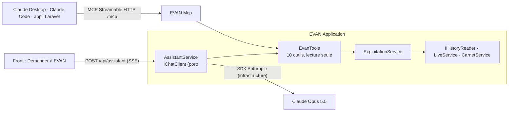

# Exploitation : maintenance, énergie, organisation, assistant et MCP

Une fois l'usine configurée, EVAN ne s'arrête pas à la supervision en direct. Ce document décrit les écrans
d'exploitation ajoutés, les solutions comparées pour chacun et ce qui a été retenu.

| Écran ou service | Où | Ce qu'il fait |
|---|---|---|
| **Maintenance** (onglet) | `src/EVAN.Front/src/pages/maintenance/` | Carnet : tâches à planifier, dérives détectées, journal des interventions, indicateurs, consignation d'un bon de travail |
| **Revoir la panne** | `widgets/pannes/ReplayDialog.tsx` | Une panne rejouée : machine en 3D, courbe de la mesure, étapes horodatées |
| **Défaut répétitif** | `widgets/pannes/RepeatDefectTool.tsx` | Pas mesuré entre deux défauts → cylindre ou rouleau en cause |
| **Énergie** (onglet) | `pages/energie/` | kWh par état, courbe de charge, intensité par étiquette, CO₂, coût, gisements |
| **Vue d'ensemble** | `pages/organisation/` | Toutes les usines comparées, machines comparables d'une usine à l'autre |
| **Demander à EVAN** | `widgets/assistant/`, `src/EVAN.Application/Assistant/` | Question en langage naturel, réponse de Claude appuyée sur les données |
| **Serveur MCP** | `src/EVAN.Mcp/`, `/mcp` | Les mêmes outils pour Claude Desktop, Claude Code ou toute application cliente MCP |
| **Compte** | `pages/compte/`, `/compte` | Connexion à son organisation, membres, configuration des passerelles (§ 8) |

Liens directs : `/demo/maintenance`, `/demo/energie`, `/demo/organisation`, `/demo/historique`. Les anciens liens
`/demo?ecran=maintenance` mènent au même écran.

## 1. Une seule logique, deux exécutions

La démo doit tourner sans serveur (navigateur seul) **et** le back doit répondre exactement la même chose à l'assistant
et aux clients MCP. Comme pour le moteur de règles, chaque calcul existe donc deux fois :

| Calcul | Navigateur (démo hors ligne) | Back (assistant, MCP, REST) |
|---|---|---|
| Historique simulé (périodes, alarmes, TRS, mesures) | `src/sim/history.ts` | `EVAN.Infrastructure/Simulation/HistoriqueSimule.cs` (port `IHistoryReader`) |
| Défaut répétitif | `src/analytics/repeatDefect.ts` | `EVAN.Core/Domain/Diagnostics/DefautRepetitif.cs` |
| Énergie | `src/analytics/energy.ts` | `EVAN.Core/Domain/Exploitation/Energie.cs` |
| Maintenance (échéances, prévisions, journal, indicateurs) | `src/analytics/maintenance.ts` | `EVAN.Core/Domain/Exploitation/Maintenance.cs` |
| Chronologie d'une panne | `src/analytics/timeline.ts` | `EVAN.Core/Domain/Exploitation/Chronologie.cs` |

La parité n'est pas une promesse : **des cas de test communs** la vérifient. `data/tests/historique.json` fige, pour un
instant et un fuseau donnés, les alarmes (identifiants, horodatages à la milliseconde), les périodes, le TRS, des
valeurs de mesure, les échéances, les dérives, l'énergie et trois chronologies ; le front le produit
(`src/sim/history.contract.test.ts`), le back le rejoue (`SimulatedHistoryContractTests.cs`). Même principe pour
`data/tests/defaut-repetitif.json`. L'aléa (`mulberry32`, FNV-1a) est porté bit pour bit ; les horodatages simulés sont
des millisecondes entières. Conséquence visible : un lien d'alarme cité par l'assistant (calculé par le back) ouvre la
même panne dans le navigateur.

En production, `IHistoryReader` lit TimescaleDB (`etats_machine`, `mesures`, alarmes) au lieu de simuler : les calculs
du domaine ne changent pas.

## 2. Carnet de maintenance

**Référence** : NF EN 13306 (terminologie de la maintenance) : corrective (curative), préventive **systématique**
(à intervalle), **conditionnelle** (sur l'état mesuré) et **prévisionnelle** (sur la tendance). Indicateurs usuels :
MTBF, MTTR, et ici le temps moyen d'acquittement (de l'alarme à sa prise en compte).

| Option | Pour | Contre | Retenu |
|---|---|---|---|
| Brancher une GMAO du marché | Fonctionnel complet (stocks, achats, planning) | Hors périmètre d'une démo, données d'atelier à synchroniser | Plus tard, par API |
| Carnet calculé depuis l'historique et le plan | Toujours à jour, rien à saisir pour l'existant | Ne remplace pas une GMAO | **Oui** |
| Saisie libre seule | Simple | Vide au départ, pas de lien avec les alarmes | Complément |

Ce qui est en place :

- **Plan de maintenance** par type de machine dans `data/catalog.json` (`maintenance`) : tâches systématiques en heures
  de marche (`h`) ou en jours (`j`), tâches conditionnelles sur un point d'usure (mètres d'outil, heures de blanchet,
  usure de lame). Compteur, progression, statut (à jour, à planifier, en retard) et date prévue d'après le rythme de
  marche de la machine.
- **Maintenance prévisionnelle** : régression linéaire horaire sur 7 jours de marche, retenue si R² ≥ 0,6 et si le
  seuil d'attention est franchi dans les 30 jours. Sur l'usine d'exemple, elle trouve la lampe UV de R04 (−1,3 %/jour),
  alors que le plan systématique la dit « à jour » : c'est l'argument de la prévisionnelle.
- **Journal** : chaque panne résolue (historique et session) devient une intervention curative avec son compte rendu
  type (`panne.action` du catalogue), les passages préventifs du plan y figurent, et l'atelier consigne ses bons de
  travail (une tâche du plan réalisée remet son compteur à zéro). Avec le back, la saisie part sur
  `POST /api/sites/{site}/interventions` et s'inscrit au journal de l'usine.

## 3. Revoir une panne

**Référence** : les historiens industriels rejouent une fenêtre de temps autour d'un événement (« event frames »
d'AVEVA PI, lecture d'historique des SCADA, enregistreurs de poste de conduite) : retour arrière, pause, accéléré.

| Option | Pour | Contre | Retenu |
|---|---|---|---|
| Vidéo enregistrée | Fidèle | Caméras, stockage, rien sur les mesures | Non |
| Rejouer la scène 3D de l'usine | Spectaculaire | Mélange le direct et le passé dans la même scène | Non |
| Fenêtre dédiée : machine seule en 3D + courbe + étapes | Lisible, synchronisé, réutilise les modèles du kit | Une fenêtre de plus | **Oui** |

La chronologie (`analytics/timeline.ts`) découpe la fenêtre « 10 min avant l'alarme → retour en production » en
images (720 au plus, une à l'instant exact de l'alarme) et repère les étapes : début de la dérive, seuil d'attention,
alarme et arrêt, acquittement, fin d'intervention, redémarrage, production. La lecture va de ×1 (panne de la session,
rejouée depuis le tampon temps réel) à ×240. L'historique simulé a été rendu cohérent pour cela : la mesure atteint le
seuil d'alarme à l'instant de l'alarme, et la machine repart par un calage de reprise.

## 4. Défaut répétitif → pièce tournante

**Référence** : les systèmes d'inspection de bande rapprochent la distance de répétition d'un défaut des
circonférences des rouleaux de la ligne ; plusieurs rouleaux de même diamètre sont l'écueil connu, que l'on lève par
l'aspect et la position du défaut (brevets US7797133, US8935104).

Retenu : une **table des circonférences** par organe (`cylindres` dans le catalogue : diamètre ou développement, et
nature : impression, découpe, marque, dorure), le rapport 1 (une marque par tour) et les harmoniques ×2 et ×½ avec une
tolérance plus stricte, tolérance de 1,5 % (mesure à ±1 mm, glissement de bande), et l'aspect du défaut pour départager
les pièces de même développement (sur une presse étiquettes, cylindre porte-cliché, cylindre magnétique et contre-
cylindre ont tous le développement de la répétition). Saisie en millimètres ou en « toutes les N étiquettes ».

## 5. Énergie et CO₂

**Références** : ISO 50001 (indicateur de performance énergétique, ici kWh pour 1 000 étiquettes imprimées) ; courbe
de charge et pic face à la puissance souscrite ; facteur d'émission du mix moyen de consommation (Base Empreinte de
l'ADEME, ordre de grandeur 40 gCO₂e/kWh en cycle de vie).

| Option | Pour | Contre | Retenu |
|---|---|---|---|
| Compteurs d'énergie par machine (Modbus) | Mesure réelle | Matériel à poser | Cible : même chaîne que les mesures |
| Puissance par état × temps passé dans l'état | Disponible tout de suite, montre où part l'énergie | Estimation | **Oui pour la démo** |

Ce qui est en place : puissance par état et par type de machine (`energie` dans le catalogue : marche, calage, panne
sous tension, veille), kWh par état, par jour et par machine, intensité par machine et par usine (toute l'énergie
rapportée aux seules étiquettes imprimées, pour ne pas compter deux fois ce que la refendeuse retravaille), courbe de
charge et pic, émissions et coût (facteur et prix modifiables à l'écran), et **gisements** chiffrés à l'année : veille
hors production, calages, pannes sous tension, machine plus gourmande que ses semblables.

## 6. Vue d'ensemble de l'organisation

Les mêmes indicateurs, calculés de la même façon pour chaque usine (TRS pondéré par l'ouverture, disponibilité,
pannes, MTTR, énergie, intensité, maintenance en retard, dérives), les plans teintés par les arrêts, le TRS jour par
jour usine contre usine, les arrêts les plus longs de l'organisation et un tableau des **machines comparables** (même
type) d'une usine à l'autre. Le direct reste propre à chaque usine (une passerelle, un flux) : la vue d'ensemble
l'affiche pour l'usine ouverte.

## 7. Demander à EVAN et serveur MCP

Un serveur MCP peut s'écrire dans n'importe quel langage, Laravel compris. Le protocole n'impose rien : la question est
de savoir qui possède les données.

| Option | Pour | Contre | Retenu |
|---|---|---|---|
| Serveur MCP en Laravel (`laravel/mcp`) | Bien pour exposer le CRM et l'ERP s'ils sont en PHP | Les données d'atelier sont dans le back .NET : il faudrait les recopier ou les relayer | Pour les données de gestion |
| Serveur MCP en TypeScript à côté du front | Réutilise la logique du navigateur | Troisième environnement d'exécution en production | Non |
| **Serveur MCP dans le back .NET** (SDK C# officiel, `ModelContextProtocol.AspNetCore`) | Réutilise les cas d'usage, même hébergement que l'API, Streamable HTTP sans état | — | **Oui** |
| Assistant dans le navigateur, clé côté client | Simple | La clé d'API fuit | Non |
| **Assistant côté serveur** (SDK officiel d'Anthropic + `Microsoft.Extensions.AI`) | Clé sur le serveur, outils exécutés près des données, réponse en flux | Exige le back | **Oui** |

Architecture :



- **Outils définis une fois** (`EvanTools`, attribut `[OutilEvan]` et descriptions en français) : l'assistant les
  reçoit en fonctions `AIFunction`, le serveur MCP en `McpServerTool` annotés lecture seule. `organisation`, `machines`,
  `etat_usine`, `alarmes`, `arrets`, `chronologie_panne`, `carnet_maintenance`, `energie`,
  `diagnostic_defaut_repetitif`, `mesure`. Une demande impossible renvoie `{ erreur, … }` avec les choix valides pour
  que le modèle se corrige (« R01 » existe dans les deux usines).
- **Assistant** : `claude-opus-5-5`, réflexion adaptative (par défaut sur ce modèle), effort du modèle sauf réglage,
  repli côté serveur sur un autre modèle si une demande est déclinée (`server-side-fallback-2026-07-01`, désactivable
  par `Evan:Assistant:RepliSurRefus=false`), huit allers-retours d'outils au plus. Réponse en SSE : on voit les outils
  consultés, puis le texte ; machines et alarmes sont citées en liens (`[R01](machine:m-r01)`) qui ouvrent la machine
  ou rejouent la panne. Outils et consignes sont relus du cache de prompt ; l'usine regardée et l'heure de Paris
  viennent après (voir « Cache de prompt, effort et coût »).
- **Sécurité** (détail ci-dessous) : la clé (`ANTHROPIC_API_KEY` ou `Evan:Assistant:CleApi`) ne quitte jamais le serveur ; tous les
  outils sont en lecture, aucun ne pilote une machine (l'écriture reste derrière le garde-fou de la passerelle).
- **Couches** : `EVAN.Application` ne connaît que l'abstraction `IChatClient` ; le SDK d'Anthropic est dans
  l'infrastructure ; `EVAN.Mcp` ne voit que l'application. Vérifié par `tests/EVAN.Architecture.Tests`.

### Accès, débit et coût

Chaque question consomme la clé payante du serveur : sans garde, quiconque atteint l'API la dépense. Le serveur MCP ne
coûte pas d'appel au modèle, mais il lit les données des usines.

| Option | Pour | Contre | Retenu |
|---|---|---|---|
| Aucune garde (démo locale) | Rien à configurer | Clé dépensable et données lisibles par tout client qui atteint l'API | Non |
| Comptes utilisateurs (OpenID Connect, Entra ID) | Vraie identité, droits par usine | Exige l'annuaire de l'entreprise, hors de portée de la démo | À l'intégration dans l'entreprise |
| `AddRateLimiter` d'ASP.NET Core seul | Standard | Limite le débit sans contrôler l'accès ; une politique = un limiteur, sans motif distinct | Les mêmes limiteurs (`System.Threading.RateLimiting`), appliqués par la garde |
| **Garde EVAN** : poste local libre, code d'accès pour le réseau, limites de débit et de coût | Aucune friction en local, réseau **refusé par défaut**, coût borné quoi qu'il arrive | Code partagé, pas d'identité | **Oui** |

`GardeIa` (`src/EVAN.Api/Securite/`) sert les routes marquées `ProtegerIa` : `POST /api/assistant` et `/mcp`. Dans
l'ordre :

1. **Taille** : 128 Ko par requête (413 au-delà, corps en flux compris).
2. **Accès** :
   - le **poste du serveur** passe sans code (navigateur derrière le proxy de Vite, Claude Code en local), à condition
     que l'origine soit celle du front ou une origine locale : une page tierce qui fait pointer son nom vers 127.0.0.1
     (rebond DNS) est refusée ;
   - un **client réseau** présente le code (`Authorization: Bearer <code>`, comparé à temps constant). Sans code
     configuré, il est refusé (403). Après dix codes faux, le client est bloqué avant toute comparaison (un essai
     toutes les 90 s) ;
   - « local » se décide sur l'adresse de la connexion **et** sur chaque adresse de `X-Forwarded-For` : un en-tête
     forgé peut retirer l'accès local, jamais le donner. Derrière nginx (Docker), tout client est « réseau ».
3. **Conversation** : 20 messages, 4 000 caractères par message, 24 000 en tout ; rôles `user` et `assistant`
   seulement, la dernière doit être la question (400 sinon, avant tout appel au modèle).
4. **Débit et coût** (429 avec `Retry-After` et un motif en clair) : 6 questions par minute et 2 réponses en cours par
   client, 4 réponses en cours en tout, **300 questions par 24 h** pour l'installation ; 120 requêtes MCP par minute et
   par client. Une réponse dure 3 minutes au plus.

Tout se règle dans `Evan:Assistant` (`CodeAcces`, `QuestionsParMinute`, `QuestionsSimultanees`, `QuestionsParJour`,
`RequetesMcpParMinute`, `SecondesMax`). Les compteurs vivent en mémoire : un redémarrage les remet à zéro. Le plafond de
dépense du **workspace** dans la console Anthropic reste la dernière borne, à poser dans tous les cas. En Docker,
nginx limite aussi par adresse (`limit_req`), l'API n'est publiée que sur 127.0.0.1, et `EVAN_CODE_ACCES` (`.env`)
ouvre l'assistant et le MCP au réseau. Côté front, le panneau demande le code quand le back l'exige et le garde le
temps de l'onglet (`sessionStorage`).

Vérifié par `tests/EVAN.Api.Tests` (serveur de test, modèle simulé dont on compte les appels : une requête refusée ne
coûte rien).

Brancher un client MCP sur le back lancé (`scripts/dev.ps1`) :

```bash
claude mcp add --transport http evan http://localhost:8080/mcp          # Claude Code
npx mcp-remote http://localhost:8080/mcp                                  # passerelle stdio pour Claude Desktop
```

Depuis un autre poste, avec le code d'accès :

```bash
claude mcp add --transport http evan http://serveur-evan:8088/mcp --header "Authorization: Bearer <code>"
npx mcp-remote http://serveur-evan:8088/mcp --header "Authorization: Bearer <code>"
```

Questions de démonstration : « Pourquoi la Gallus s'est-elle arrêtée ce matin ? », « Que faut-il planifier cette
semaine ? », « Combien coûte la veille des machines par an ? », « Un défaut revient tous les 339,5 mm sur R01 : quelle
pièce ? », « Compare Tours et Crissey ».

### Cache de prompt, effort et coût

Chaque aller-retour d'outil renvoie au modèle tout le prompt, lu dans l'ordre outils, système, messages. Sans cache, ce
qui ne change jamais est refacturé au plein tarif à chaque appel. Tailles mesurées sur les requêtes telles que le SDK
les envoie, capturées par un faux serveur Anthropic (texte décodé, hors échappements JSON) :

| Partie du prompt | Taille | Change |
|---|---|---|
| Définitions des dix outils (JSON) | 6 067 caractères | jamais : ordre de déclaration figé (`EvanTools.Methodes`) |
| Consignes (`AssistantService.Consignes`) | 1 251 caractères | jamais : ni heure ni usine regardée |
| Contexte (`AssistantService.Contexte`) : usine regardée, heure de Paris | 150 caractères environ | à chaque question |
| Question, appels et résultats d'outils | de 707 à 13 693 caractères de résultats par question du jeu d'évaluation | à chaque aller-retour |

Deux points de cache, sur les quatre que permet l'API :

1. **À la fin des consignes.** L'assistant marque ce bloc (`AssistantService.FinDuPrefixeStable`) et
   `PointDeCacheChatClient` (infrastructure) y pose `cache_control` : outils et consignes sont relus du cache d'une
   question à l'autre, pour peu qu'il en arrive une toutes les 5 minutes (durée de vie du cache, relancée à chaque
   lecture). Les cas d'usage ne voient toujours que `IChatClient`.
2. **En tête de la requête** (`CacheControl` des paramètres de base, `AssistantRegistration.Parametres`) : l'API pose
   le point sur le dernier bloc, si bien que chaque aller-retour d'une même question relit tout ce qui précède.

`tests/EVAN.Infrastructure.Tests/Assistant/AssistantClaudeTests.cs` fait passer de vraies questions par le SDK, son
adaptateur et l'exécution des outils jusqu'à un faux serveur, et vérifie sur les requêtes : outils et consignes
identiques à l'octet près d'une usine et d'une heure à l'autre, heure et usine après le point de cache, deux points et
pas un de plus au fil des allers-retours (le contenu marqué est recopié, sinon chaque appel en ajouterait un), cache posé
avec ou sans repli. L'adaptateur part des paramètres de base et y ajoute messages, système et outils sans toucher au
cache, à l'effort ni au repli.

Ce qui fait repartir d'un cache vide : un autre modèle, une modification des outils ou des consignes, plus de 5 minutes
sans question. Changer d'effort invalide au moins la suite de la conversation. Au neuvième appel d'une question (borne
des huit allers-retours atteinte), `FunctionInvokingChatClient` retire les outils de la requête : ce dernier appel ne lit
pas le cache.

L'écriture dans le cache coûte 1,25 fois l'entrée, la lecture 0,20 $ par million de jetons sur les deux modèles. Une
question qui s'arrête au deuxième aller-retour y écrit des résultats d'outils qu'aucun appel ne relira : le surcoût porte
sur ces jetons seuls, et un troisième aller-retour le rembourse.

**Effort** : `Evan:Assistant:Effort` vaut `low`, `medium`, `high`, `xhigh` ou `max`, envoyé en `output_config.effort`.
Vide (par défaut), rien n'est envoyé et le modèle garde le sien (`medium` sur Claude Opus 5.5). Une valeur inconnue
arrête le démarrage. La réflexion reste adaptative : Claude Opus 5.5 ne permet pas de la couper, l'effort est le seul
réglage.

**Coût de chaque question** : à la fin d'une réponse, `AssistantService` additionne les décomptes de tous les
allers-retours et écrit une ligne au journal (catégorie `EVAN.Application.Assistant.AssistantService`) :

```
Réponse de l'assistant {complète|interrompue} : modèle {Modele}, effort {Effort}, allers-retours {AllersRetours},
jetons en entrée {Entree}, en sortie {Sortie}, écrits en cache {EcritureCache}, lus en cache {LectureCache},
coût estimé {CoutDollars} $
```

L'entrée compte les seuls jetons au plein tarif ; la sortie comprend la réflexion. Une réponse interrompue (navigateur
parti, délai dépassé, modèle injoignable) est journalisée avec ce qu'elle a déjà consommé. Ce bilan ne part pas au
navigateur. Les prix, en dollars par million de jetons, se règlent dans `Evan:Assistant:Prix:{modèle}` :

| Modèle | `Entree` | `Sortie` | `LectureCache` | `EcritureCache` |
|---|---|---|---|---|
| `claude-opus-5-5` | 4 | 20 | 0,20 | 5 |
| `claude-sonnet-5-5` | 2 | 10 | 0,20 | 2,5 |

Ce sont les valeurs par défaut (`AssistantRegistration.TarifsParDefaut`, prix publiés par Anthropic ; l'écriture d'un
cache de 5 minutes vaut 1,25 fois l'entrée). La configuration en remplace une ou ajoute un modèle (`Entree`, `Sortie` et
`LectureCache` obligatoires, `EcritureCache` déduite de l'entrée si elle manque). Pour un modèle sans prix connu, le
journal donne les jetons et aucun coût. L'estimation suit le prix du modèle configuré, même quand le repli sur refus
fait reprendre la réponse par un autre modèle.

### Évaluer les réponses

`data/tests/assistant-questions.json` pose 18 questions d'atelier : TRS d'une usine et d'une machine, machine la plus
arrêtée, organe en cause, cause d'arrêt principale, alarmes répétitives, MTTR et MTBF, kWh pour 1 000 étiquettes,
consommation, machine la plus gourmande, coût de la veille, comparaison des deux usines, dérive, défaut répétitif,
maintenance en retard. Aucune réponse n'y est écrite : chaque question nomme l'outil qui la calcule et les champs à
retrouver dans le texte du modèle, recalculés par `ExploitationService` sur l'historique simulé à l'instant figé du
fichier (jeudi 8 octobre 2026, 10 h 30 à Paris).

Le correcteur (`tests/EVAN.Infrastructure.Tests/Assistant/Evaluation/Correcteur.cs`) cherche chaque nombre à une
tolérance relative près (écrit à la française ou à l'anglaise, une durée en heures ou en minutes, une énergie en kWh ou
en MWh), chaque texte sans tenir compte de la casse ni des accents, chaque machine par son lien ou son numéro.
Identifiants et cibles de liens (`R01`, `EM-01`, `machine:m-r01`) ne comptent pas comme des nombres. Score d'une
question : la part de ses vérifications réussies.

Sans appel au modèle, dans la suite normale : le correcteur sur des réponses écrites à la main, bonnes et mauvaises ;
chaque question calculée deux fois à l'identique ; une réponse qui reprend les valeurs attendues notée juste, une réponse
décalée de 10 % notée zéro ; le rapport construit avec un modèle simulé.

Contre le modèle, ce qui coûte : la clé reste dans l'environnement, jamais dans un fichier suivi.

```bash
EVAN_EVAL=1 dotnet test tests/EVAN.Infrastructure.Tests -c Release \
  --filter "FullyQualifiedName~EvaluationAssistant" --logger "console;verbosity=detailed"
```

| Variable | Rôle |
|---|---|
| `ANTHROPIC_API_KEY` | obligatoire |
| `EVAN_EVAL_MODELE` | modèle, `claude-opus-5-5` par défaut |
| `EVAN_EVAL_EFFORT` | `low` à `max`, celui du modèle par défaut |
| `EVAN_EVAL_QUESTIONS` | identifiants séparés par des virgules, pour un essai sur quelques questions |
| `EVAN_EVAL_SORTIE` | dossier du rapport, `evaluation/` à côté des binaires de test par défaut |
| `EVAN_EVAL_SEUIL` | score moyen minimal (0 à 1) sous lequel le test échoue ; sans lui, il mesure seulement |

Les questions partent l'une après l'autre, avec le pipeline de production (cache, effort, repli) : dès la deuxième, outils
et consignes sont lus dans le cache. Le rapport Markdown donne le score, les jetons et le coût de chaque question, puis
le texte des réponses manquées avec ce qui y manque.

Pour budgéter un passage complet : outils et consignes font 7 318 caractères, relus du cache dès la deuxième question ;
contexte et question en ajoutent quelques centaines ; les résultats des outils attendus font 107 335 caractères pour les
18 questions. La sortie, réflexion comprise, ne se mesure qu'avec le modèle : sur Claude Opus 5.5, chaque millier de
jetons de sortie par question ajoute 0,36 $ au passage complet (18 × 1 000 jetons à 20 $ le million).

## 8. Installer EVAN pour l'entreprise : comptes, usines, passerelles

EVAN est l'outil interne d'une entreprise, pas un service ouvert à d'autres clients. La démo marche sans compte ;
l'exploitation réelle a besoin de plus : que les usines soient gardées par le serveur, que seules les équipes de
l'entreprise y accèdent, et que chaque passerelle reçoive la configuration saisie à l'étape 5.

| Option | Pour | Contre | Retenu |
|---|---|---|---|
| Inscription publique | Aucun geste de l'exploitant | N'importe qui crée des organisations sur le serveur | Non |
| Commande en ligne de l'API | Rien d'exposé sur le réseau | En Docker, il faut entrer dans le conteneur ; le mot de passe passe par l'historique du shell et la liste des processus | Non |
| **Route d'installation protégée par un code** (`POST /api/installation`) | Marche en Docker comme sans, testée, mot de passe dans le corps d'une requête HTTPS | Un secret de plus à garder | **Oui**, fermée quand le code est vide |
| Annuaire de l'entreprise (OpenID Connect, Entra ID) | Vraie identité, une seule connexion | Dépend de l'annuaire de chaque client | Plus tard |

Le parcours, de bout en bout :

1. **Code d'installation.** `EVAN_CODE_INSTALLATION` dans `.env` (16 caractères au moins, `openssl rand -base64 24`),
   puis redémarrer l'API. Vide, la route n'existe pas (404).
2. **L'organisation et son administrateur** :

   ```bash
   curl -X POST http://localhost:8088/api/installation -H 'Content-Type: application/json' -H 'X-Evan: 1' \
     -d '{"code":"<code>","organisation":"Imprimerie Dupont","identifiant":"claire@dupont.fr","nom":"Claire Martin","motDePasse":"<12 caractères au moins>"}'
   ```

   Cinq codes faux depuis une même adresse, et la route attend cinq minutes. L'installation ne réussit qu'une fois :
   l'entreprise a son organisation, une seconde demande reçoit 409. Vider ensuite le code ferme la route (404).
3. **Les membres.** L'administrateur se connecte sur `/compte` et crée les comptes de son organisation (membre ou
   administrateur), avec un mot de passe provisoire que chacun change ensuite depuis la même page.
4. **L'usine.** `/assistant`, connecté : l'organisation vient du serveur, et chaque usine modifiée y repart quelques
   secondes après, et à « Terminer ». Un refus nomme le champ en cause (« Machine R03 : nom requis »). Un modèle 3D
   importé reste dans le navigateur : sa machine n'est pas envoyée.
5. **La passerelle.** Sur `/compte`, l'administrateur télécharge l'appsettings.json de chaque usine : machines,
   variables associées, `AllowedTestTargets` (les hôtes des automates) et le broker `EVAN_BROKER_PASSERELLES`. Aucun
   mot de passe n'y figure : celui d'un automate OPC UA se règle sur la passerelle elle-même (`Parameters.motDePasse`),
   EVAN refuse de le garder.
6. **Le certificat et les droits MQTT**, sur le poste qui garde la clé de l'autorité :

   ```bash
   infra/mosquitto/ajouter-passerelle.sh site-dupont gw-dupont
   ```

   Le script signe le certificat client (CN = la passerelle), l'écrit dans `infra/mosquitto/certs/gw-dupont/` avec le
   certificat public de l'AC, et affiche le bloc à ajouter à `infra/mosquitto/acl` : la passerelle n'écrit que pour son
   usine et ne lit que ses commandes. `docker compose kill -s HUP mqtt` recharge les droits sans couper personne.
7. **Dans l'usine** : ce dossier sous le nom `certs/`, l'appsettings.json à côté de `EVAN.Gateway`, puis démarrer le
   service. Les machines passent « en direct » dans la supervision dès les premières mesures.

Ce qu'il faut savoir en exploitation :

- **Sessions** : 8 h sans activité au plus. Les clés qui chiffrent le cookie vivent dans `Evan:DossierCles` (volume
  `api-data` en Docker) : une mise à jour de l'API ne déconnecte personne. Changer de mot de passe ne ferme pas les
  sessions déjà ouvertes, qui s'éteignent à leur expiration.
- **Taille d'une configuration** : l'usine d'exemple de Tours (14 machines, 212 points) pèse 85 ko en JSON. L'API
  accepte 4 Mo sur `PUT /api/sites/{id}` ; le relais nginx laisse passer autant sur cette route (64 ko ailleurs).
- **Écritures** : toute écriture sur `/api` porte l'en-tête `X-Evan: 1` (le front le pose). Un script qui écrit dans
  l'API doit le poser aussi.
- **Démo** : `Evan:DemoEnabled=false` ferme ses usines à tous (404), routes `/api/demo` comprises.
- **Ce qui manque encore** : supprimer un compte ou une usine, renommer une organisation, retrouver côté serveur les
  interventions consignées dans le carnet (elles y sont enregistrées, le front ne les relit pas).

## Sources

- SDK C# du Model Context Protocol : https://csharp.sdk.modelcontextprotocol.io/ · paquet `ModelContextProtocol.AspNetCore` (NuGet)
- Laravel MCP : https://laravel.com/ai/mcp · paquet `laravel/mcp` (Packagist)
- Défauts répétitifs et rouleaux : brevets US7797133 et US8935104 (Google Patents)
- Relecture d'historique : AVEVA PI Vision (event frames), GEA Codex Plant Playback
- Facteur d'émission de l'électricité : documentation Base Carbone / Base Empreinte de l'ADEME (« Mix de consommation - moyen »), bilans électriques de RTE
